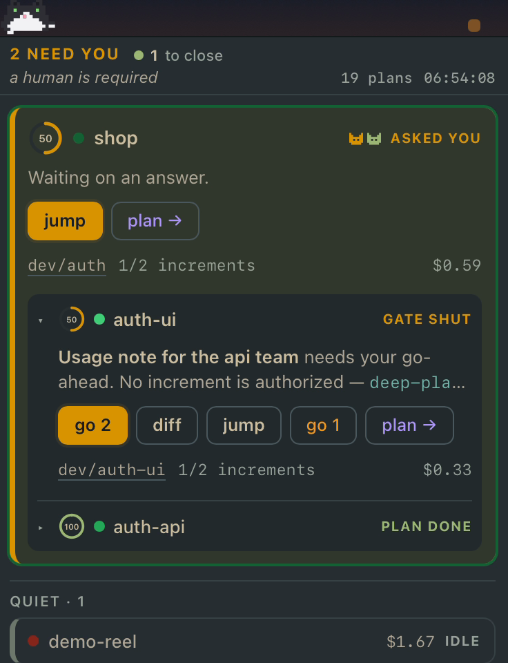
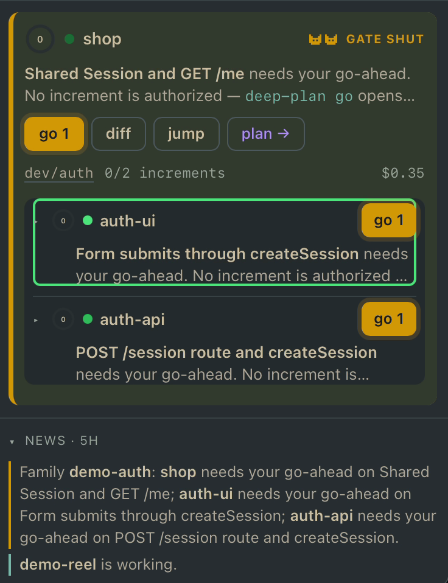
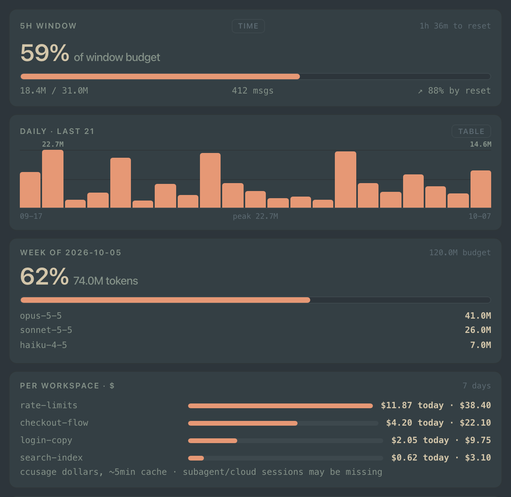
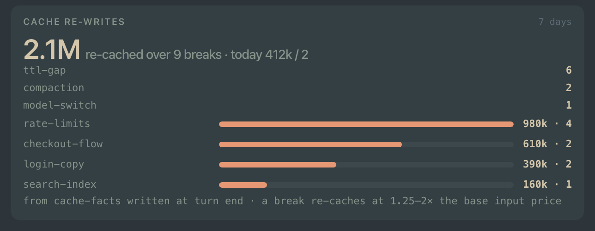
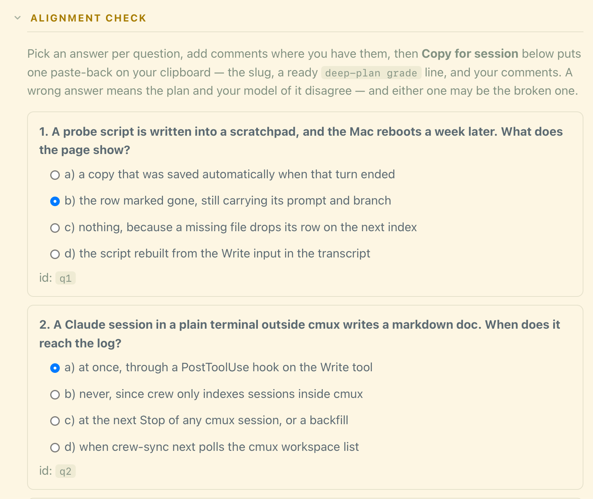
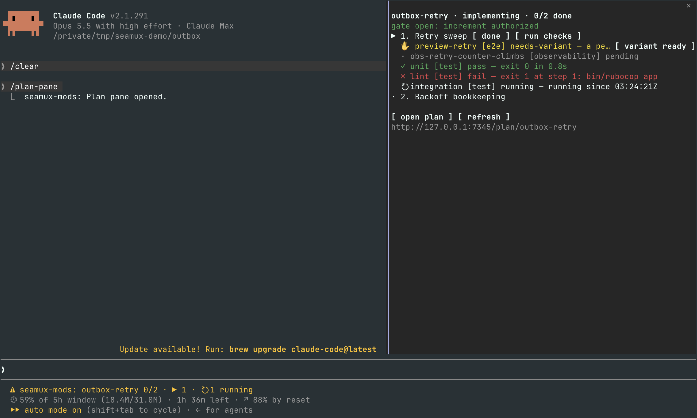
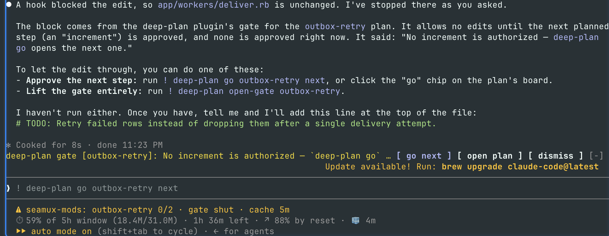

# seamux

seamux helps you run many Claude Code agents at once and keep track of them.
It is a set of Claude Code plugins. Take the one you came for, or all of them.

| plugin | what it does | runs on |
|---|---|---|
| **crew** | A board in the [cmux](https://cmux.io) Dock that ranks your worktrees by which one needs you next. | macOS with cmux |
| **deep-plan** | Turns "make a plan" into a page you review, with a short quiz. The agent can't edit until you approve each increment, and can't call an increment done until its checks pass. | anywhere Claude Code runs |
| **restack** | Rebases a stack of branches onto a moved base and regenerates conflicting generated files instead of making you merge them. | anywhere Claude Code runs |
| **lookout** | Opens a diff beside the terminal, riskiest files first, with a reviewer's findings on their lines for you and the agent to talk through. A plan can make an increment wait on its review. | anywhere Claude Code runs |
| **humanize** | Rewrites prose so it reads like a careful human wrote it: strips AI writing tells and untangles sentences that are hard to parse. Other seamux skills use it on the text they write. | anywhere Claude Code runs |
| **seamux-mods** *(optional)* | Draws deep-plan inside the terminal: a plan pane, a `go next` prompt when the gate blocks an edit, and the plan in the status line. | Claude Code 2.1.287+ |

deep-plan and lookout don't need cmux. They serve their own pages in Claude
desktop or a terminal, a repo can carry them into claude.ai/code cloud
sessions, and a plan can sync through git so several machines and people
work it together. See [Where it runs](#where-it-runs) and
[Working as a team](#working-as-a-team).

Out of the box you only need git and GitHub. If your team uses Jira, GitHub
Issues, Datadog, Splunk or Grafana, turn those on in the crew plugin's options and the
board and the planner will use them. With Remote Control on, the same board
shows up in the Claude phone app.

**Quick start**

```sh
git clone https://github.com/rickykoter/seamux ~/code/seamux
cd ~/code/seamux && ./install.sh
```

Then ask Claude for a "deep plan" of any change. [Setup](#setup) has the
details and the options. Rolling it out to a team, or to cloud sessions?
Read [docs/ADOPTING.md](docs/ADOPTING.md).

**Setting up with an agent?** Point it at
[Install or update with an agent](#install-or-update-with-an-agent). It
covers a first install and an update, and what to ask you along the way.

**Contents:** [How a change runs](#how-a-change-runs) ·
[Tour](#tour) ·
[Where it runs](#where-it-runs) ·
[Working as a team](#working-as-a-team) ·
[Plugins](#plugins) ·
[Setup](#setup) ·
[Configuration](#configuration) ·
[Security notes](#security-notes) ·
[Layout](#layout)

## How a change runs

You ask Claude for a deep plan. From there a change moves down one line, and
each station leaves something you can check before the next one starts.

| station | who | command | leaves |
|---|---|---|---|
| **Plan** | the agent asks, you answer | `deep-plan render <spec> --root <worktree>` | a plan page with decisions, cited facts, risks and diagrams |
| **Align** | you | `deep-plan grade <slug> q1=a q2=c …` | a short quiz passed, and the plan as agreed in `<slug>.approved.md` |
| **Go** | you, or a family's parent agent | `deep-plan go <slug> next` | one open increment; the gate refuses every edit outside it |
| **Build** | the agent | edits inside the increment | commits, one increment at a time |
| **Prove** | the engine, and you for manual checks | `deep-plan check run <slug> <n>` | a verdict per check; `done` waits for all of them |
| **Review** | a fresh reviewer agent; you close what matters | `lookout gate --plan <slug> --inc <n>` | findings on their lines; an open blocker or major holds the gate |
| **Ship** | you | `deep-plan deliver <slug>` | a reviewed branch, its evidence, and tickets if you want them |

A big goal does not have to run down one line. A parent plan splits it into
workstreams, each its own plan, worktree and agent, and they join at the end
(see [Families](#families-one-goal-parallel-workstreams)). restack moves a
branch onto its moved base without hand-merging generated files, and on cmux
the crew board shows every worktree on the line, ranked by which one needs
you next.

https://github.com/user-attachments/assets/380fe3fe-fbe7-4215-89e1-f3929e0b8720

The plugins in detail: [deep-plan](deep-plan/README.md),
[lookout](lookout/README.md), [restack](restack/README.md),
[humanize](humanize/README.md), [crew](crew/README.md) and
[seamux-mods](seamux-mods/README.md).

## Tour

One change to a throwaway shop app, made by three Claude Code sessions: a
parent plan and two workstreams, one for the API and one for the web form.
Each session plans its part with deep-plan, and you check every plan on its
review page before any code is written. That means a short quiz, a
disposition for each risk, and a question answered with a picture. The gate
refuses edits until you say `go`, and the ui's `go` waits on the parent. The
crew board shows the family as one card, with each workstream's own `go`
inside it. The plan pane tracks increments and their checks in the
terminal. restack moves the API branch onto the parent's work and
regenerates the route table instead of merging it. lookout reviews the
diff beside the terminal, and its quiz was answered wrong on purpose to
show what happens: the note puts your answer next to what the code does.
The parent merges both workstreams, proves sign-in end to end, and the
whole family reads done.

https://github.com/user-attachments/assets/cb23e079-9b94-466c-8e8b-fd278c0c2155

_Note: The sessions, plans, checks, and commits are real, on a throwaway repo. 
Portions are sped up for convenience._

## Where it runs

Each plugin works out where Claude is running and sends every page somewhere
that host can show it.

| host | detected by | pages | plan state |
|---|---|---|---|
| cmux | `CMUX_WORKSPACE_ID` | a pane beside the terminal, through crew's server | `~/.claude` |
| Claude desktop | `CLAUDE_CODE_ENTRYPOINT` | the plugin's own server; Claude opens it in the app's browser pane | `~/.claude` |
| a terminal | none of the others | the plugin's own server; you open the printed link | `~/.claude` |
| claude.ai/code cloud | `CLAUDE_CODE_REMOTE=true` | no live page; a review is shared as an Artifact | the repo, under `.seamux/state/` (kept out of git) |
| CI | no signal, or `SEAMUX_HOST=terminal` | none; checks and verdicts are the output | whatever the job restores |

Outside cmux, deep-plan and lookout each start a small server on 127.0.0.1
when a page is first wanted and stop it after 30 idle minutes. Every verb
that opens a page prints `served at <url> (host: …)`. `deep-plan doctor`
says which host it detected, and `SEAMUX_HOST=cmux|desktop|terminal|remote`
overrides it. Browser checks run through Playwright and headless Chromium
wherever cmux is not the host.

A cloud session does not install the plugins a repo enables, so the repo
carries them. Run these once and commit `.claude/`:

```bash
deep-plan install-repo
```

```bash
lookout install-repo
```

Each copies its plugin into `.claude/skills/<plugin>/` and merges its hooks
into `.claude/settings.json`. The hooks run only in a cloud session (or with
`SEAMUX_REPO_HOOKS=1`), so your own machine keeps using the installed
plugins, and `install-repo --check` says when the repo's copy is behind.
[docs/ADOPTING.md](docs/ADOPTING.md) covers the rollout, including what a
cloud session needs to push.


https://github.com/user-attachments/assets/9f407b84-5f6d-451c-bb42-5b10d80b30af


## Working as a team

### Families: one goal, parallel workstreams

A parent plan names its workstreams in a `workstreams` block. Each one is a
plan of its own, in its own worktree, with its own agent and gate, and each
claims the files it owns. A child waits on the parent increments it depends
on, hears what its siblings finished at its next prompt, and is flagged when
it edits a sibling's files. With `go: "parent"`, the parent agent gives a
child its go once the child's checks pass, so you are not needed for every
increment; you can still hold a child or take its go back. The parent
checks the whole at the end, and one review reads every member's delivery.
More in [deep-plan's README](deep-plan/README.md#families-parallel-workstreams-with-one-goal).

https://github.com/user-attachments/assets/a8c303bd-6508-4683-a68f-5898d56974a3

### Shared plan state

A plan whose spec sets `share` keeps its state on a git branch of its own,
`seamux-state/<slug>`, so a laptop, a teammate's machine and a cloud sandbox
all see the same plan. Every transition pushes the branch, and a session
pulls it when it starts. When two sessions push at the same moment, the
later one merges and pushes again, so a go or a verdict is never lost. A
family child shares through its parent, on a branch of its own, and a child
waiting for its go pulls while it waits. `deliver` and `close` turn the
branch into an archive tag. A plan that does not share stays on its machine,
and `deep-plan export-state` and `import-state` still carry it by hand.

The branch carries the plan's quiz answers, so share with people who may
see them. Exempt `seamux-state/*` from branch protection, and in cloud
sessions make sure the Claude GitHub App has access to the repo: without it
the sandbox can pull but not push. Details: [deep-plan's README](deep-plan/README.md#sharing-a-plans-state).

### Reviews across machines

lookout's review page works the same in cmux, desktop and a terminal. A
cloud session has no live page, so its review is published as an Artifact
on your say-so, and `lookout pull` brings the comments and closes back as
data, marked unverified. Only a person closes a blocker or a major, unless
the plan lets the agent.

## Plugins

### crew: the board

#### Board

One row per worktree, sorted by urgency: waiting on you, broken, working,
done, quiet. Each row shows its plan's gate, a progress dial, the branch and
PR (both clickable), today's spend, and one-tap chips. `go 3`, for example,
approves a plan increment without leaving the Dock. When nothing needs you,
the cat naps.

A deep-plan family is one card: the parent's row, with each workstream
nested inside it as a compact bar with its dial, gate, a line of status and
its `go` chip. Click a bar to open the workstream's full card and jump to
its session.



https://github.com/user-attachments/assets/f692dd27-cedc-48f2-8510-f6e0fd9f5789

#### News

The board's footer says what the rows say, as sentences: one per workspace,
or one per family, in the board's order. Shut gates and untaken alignment
checks come first, then red CI, work in progress with its increment count,
finished and merged plans, and quiet workspaces that committed in the last
five hours. Collapsed, it shows the first sentence. Open, it shows them all.



It is rebuilt on every push from the same rows, so it can't disagree with the
cards above it, and no model writes it. `crew-digest` opens with the same
sentences in the terminal, and `crew-digest --paragraph` prints them as one
line to paste. Inside a [plan family](deep-plan/README.md#families-parallel-workstreams-with-one-goal),
each session also hears what changed at its next prompt. More in
[the board README](crew/board/README.md#the-news-footer).

#### Usage

Tokens against your 5-hour and weekly budgets, a 21-day history, and dollars
per workspace, so a worktree that is quietly burning money stands out.



#### Cache

Every prompt uses a server-side cache. When it expires, the next prompt
writes your whole context back into it at a premium. Most expiries are a
session left idle past the cache's lifetime (five minutes or an hour,
depending on how you pay), and you normally don't notice until the bill.
crew makes it visible:

- The status line shows a freshness clock (`🧊 42m`).
- A desktop notification fires a minute before an idle session goes stale.
- When a turn does break the cache, you're told right away how many tokens
  were re-cached and why (compaction, a model switch, an idle gap).
- `/usage` keeps the weekly tally: re-cached tokens, their causes, and the
  sessions that cost the most.

Detection reads your local transcripts, not the API, and the cache lifetime
comes from your billing mode and settings.



What to do with a warning:

- A break you already took is a sunk cost. You only pay for the re-cache if
  you prompt again, so a session that was nearly done can just lapse.
- A cold cache is the cheap time for disruptive changes like switching
  model, toggling a plugin or upgrading, since each of those breaks the cache
  anyway.
- Answer a stale warning only with a prompt you meant to send. A cache read
  costs about a tenth of the normal input price and a write up to double, so
  sending your next real step a minute early is nearly free. Prompting just
  to keep the cache warm spends real tokens to protect hypothetical ones.

More in [crew's README](crew/README.md).

### deep-plan: plans you approve one step at a time

The agent questions your goal, asks about every fork that would be hard to
undo, and checks what it isn't sure of before it writes a plan. The plan
opens as a page with a short quiz. The agent can't edit until the quiz
passes and you say `go`, one increment at a time, and can't call an
increment done until its checks pass. Plans split into families of
workstreams and can sync through git.
[deep-plan's README](deep-plan/README.md) has the pages, checks, contracts,
risks, ADRs and families.



### lookout: review a diff with the agent

Opens a branch, a commit range or the working tree as a review page, files
ranked by risk. A fresh reviewer agent files findings on their lines, each
with a failure scenario, and you and the agent talk them through in
threads. A plan can make an increment wait on its review.
[lookout's README](lookout/README.md).

### restack: rebase without merging generated files

Rebases a stack of branches onto a moved base. Where a conflict is in a
generated file (a schema, a client, a lockfile), it regenerates the file
instead of making you merge it, then runs the staleness and breaking-change
checks CI would, and stops before the push.
[restack's README](restack/README.md).

### humanize: prose that reads like a person wrote it

Rewrites prose to remove AI writing tells and untangle sentences that are
hard to parse. The other skills run it over the text they write for people.
[humanize's README](humanize/README.md).

https://github.com/user-attachments/assets/4207e5f2-8a98-486f-9f18-3542f4edf82f

### seamux-mods: deep-plan in the terminal

An optional plugin that draws deep-plan inside Claude Code, so you can steer
a plan without leaving the session. It needs Claude Code 2.1.287 or later;
install it with `./install.sh --mods`.

`/plan-pane` opens a pane with the plan's increments and each one's checks,
with buttons for `go next`, `done`, `run checks` and `variant ready`. The
status line under the prompt shows the plan's progress, the open increment,
and how many checks are running in the background.



When the gate blocks an edit, a band appears above the prompt with the
reason and a `go next` button, so approving the next increment is one key
away.



### The seamux app: everything over cmux, on a hotkey

A small Mac app that lives outside cmux and drives it over its socket. Press
⌥Space (or ⌃⌥Space) from anywhere, a full-screen cmux included, and an overlay drops in
over whatever you're doing; press it again, or Esc, and it's gone. Click
another app and that app comes in front; the hotkey brings the overlay back.
It has no Dock icon; a tray icon carries Show, Quit and the hotkey.

The first tab is the **wall**: every terminal pane in cmux as a card, showing
its last lines live (within about a second and a half of new output). Agents
waiting on you float to the top with an amber edge, then the working ones,
the idle ones and plain shells. Each agent's card has a reply box and a Jump
button. A reply types your line into that agent's pane and presses Enter;
Jump brings the pane to the front in cmux. The other tabs (Wake, Usage and
Board) frame the intent server's own pages until they're ported. The board
tab says so until the server serves `/board`.

Install it with `./install.sh --app` (see [Install](#install)). It needs cmux's
socket in `automation` mode, which `crew apply` sets.

https://github.com/user-attachments/assets/dec47bb2-e619-40ba-b40c-40477d8b37bc

## Setup

### Install or update with an agent

If you're an agent setting this up for someone, follow these steps in order.
Stop and ask the person wherever a step says to.

**First install**

1. Clone to the checkout the person will keep, such as `~/code/seamux`.
   Never install from a git worktree: the plugins run from the folder you
   install from, and break when that folder is removed.
2. Ask the person which parts they want (all five plugins, or just
   deep-plan, restack, lookout or crew), and whether they use Jira, GitHub Issues, or
   Datadog, Splunk or Grafana. For crew, also ask which repo their worktrees
   come from. Don't guess any of these; leaving them off is fine.
3. Preview with `./install.sh --dry-run` plus the flags from step 2
   (`--no-crew`, `--mods`, `--with-jira=SITE`, `--main-repo PATH`; see
   [Install](#install)), then run the same command without `--dry-run`.
4. Verify with `./install.sh --check` and, if crew is installed, `crew
   doctor`. Both must be clean.
5. Tell the person to start a new Claude Code session. Running sessions
   don't pick up the plugins' hooks. Slash commands like `/plugin` and
   `/reload-plugins` are theirs to type, not yours.

**Update**

1. In the checkout the plugins run from (`claude plugin list` shows it),
   run `git pull --ff-only`.
2. Run `./install.sh` again. It's safe to re-run, and it re-applies crew.
3. Run `./install.sh --check` and `crew doctor`, then ask the person to run
   `/reload-plugins` in open sessions.

An install made with `--github` runs a cached copy instead, and updates only
when a plugin's version changes.

**Don't:** edit `~/.config/cmux/crew` directly (`crew apply` overwrites it;
machine-local changes go in `~/.config/cmux/crew-local`), put tokens or keys
in this repo or a `.seamux/` file (integrations read them from the
environment), or push anything.

### What you need

| | why | without it |
|---|---|---|
| macOS | cmux, the Dock and the seamux app are Mac-only | no crew or app; the other plugins still run |
| [cmux](https://cmux.io) nightly | the terminals, workspaces and socket crew drives | files install, nothing shows |
| `cargo`, `node` + Xcode CLT | build the seamux app and its `seamux` CLI, which every crew tool and hook runs as | install refuses |
| `python3` | crew apply's and the bash tools' JSON helpers, and the probes | install refuses |
| Claude Code | the agents this is all for | not much point |
| `gh` *(optional)* | PR and checks chips on rows | those chips stay blank |
| `ccusage` *(optional)* | spend on rows and `/usage` | cost surfaces are absent |
| [TypeSafe](https://typesafe.ai) key *(optional)* | judgment calls: turn-end questions, board ranking, plan citation checks | those judgments don't happen |
| Rust (`cargo`) + Xcode command line tools *(optional)* | building the seamux app with `./install.sh --app` | no app; everything else works |

deep-plan, lookout, restack and humanize need only Claude Code and `node`;
the macOS and cmux rows are for crew and the app.

### Install

```sh
git clone https://github.com/rickykoter/seamux ~/code/seamux
cd ~/code/seamux
./install.sh
```

`install.sh` is a thin wrapper around `claude plugin`. It:

1. adds this checkout as the `seamux` marketplace,
2. installs deep-plan, restack, bash-guard, lookout and crew (add `--mods`
   for seamux-mods),
3. runs each engine's `setup`, which downloads a pinned, checksum-verified
   `mermaid.min.js` and `highlight.min.js` and puts `deep-plan`, `restack`
   and `lookout` on your PATH,
4. runs `crew apply`.

Because the marketplace is a folder, the plugins run straight from this
checkout. Edit a file, run `/reload-plugins` in a session, and the change is
live; there is no version to bump. `--github` installs the published copy
from GitHub instead.

To install without the script, from inside Claude Code:

```text
/plugin marketplace add rickykoter/seamux
/plugin install deep-plan@seamux
```

then run `deep-plan setup` (and `crew apply` if you installed crew).

On a machine set up by the old installer, the first run migrates it. The
`~/.claude/skills` copies, their shims, and the `settings.json` hook entries
the plugins now carry are moved into `~/.claude/seamux-migrated/<time>/`.
Nothing is deleted, and each item moves only once the plugin replacing it is
installed and enabled. `--dry-run` prints every command and the migration
list without changing anything.

The app installs on its own, after the plugins:

```sh
./install.sh --app        # add --dry-run to see each step first
```

It checks for `cargo`, `node` and the Xcode command line tools, builds the
pages and the release binaries, puts the bundle in `~/Applications/seamux.app`
and links the `seamux` CLI inside it to `~/.local/bin/seamux`. The bundle is a
copy, so unlike the plugins an edit to `app/` is not live: run `--app` again
to rebuild. A previous bundle is moved to `$TMPDIR`, not deleted, and a
running app restarts on the new one.

To try an app change before it merges, build it from a worktree or a commit:

```sh
./install.sh --app --from ../seamux.worktrees/my-change   # the folder as it is, edits included
./install.sh --app --from origin/my-branch                # any branch or sha; fetches if needed
./install.sh --app                                        # back to the checkout you keep
```

A commit is exported to `~/.cache/seamux/app-from/`, and those builds share
one cargo folder, so the next one rebuilds only what changed.
`./install.sh --check` names the commit the installed app was built from.
`--from` is for the app alone: the plugins run from the folder `install.sh`
is in, so they stay on the checkout you keep.

For scripted installs, `--main-repo PATH`, `--with-jira=SITE`,
`--with-github-issues` and `--with-observability=STACK` set the crew plugin's
options, and `--no-crew`, `--no-restack`, `--no-guard`, `--no-lookout` and
`--no-humanize` skip plugins.

### Without cmux: Claude desktop, a terminal, the cloud

Nothing more to install: deep-plan and lookout serve their own pages, as
[Where it runs](#where-it-runs) describes. A repo that cloud sessions work in
runs `deep-plan install-repo` and `lookout install-repo` once and commits
`.claude/`; [docs/ADOPTING.md](docs/ADOPTING.md) walks through it.

### Integrations

All of these are optional.

| integration | what you get | turn it on |
|---|---|---|
| Jira | A ticket key in your branch name becomes a chip on the row, colored by the ticket's state. Click it to open the ticket. `crew doctor` checks `acli` only if this is on. | crew plugin option |
| GitHub Issues | The issue a PR closes (or a `123-…` branch names) gets its own chip, using the `gh` poll crew already makes. | crew plugin option |
| Datadog, Splunk or Grafana | deep-plan reads your monitors, dashboards and runbooks before drafting a plan. What exists gets cited; what's missing becomes plan work, like new instrumentation, a monitor definition you import, or a runbook section. It only reads: changes come as files you review and apply, never as API writes. | crew plugin option `observability_stack`, or a per-repo `.seamux/observability.json` |
| TypeSafe | Three judgment calls plain code can't make (below). | a key in `$TYPESAFE_API_KEY` or the first line of `~/.config/typesafe/api-key` |

Set the crew plugin's options with `/plugin` inside Claude Code, or `claude
plugin configure crew@seamux`. If you skip them, nothing nags you and no
chips sit empty.

**TypeSafe** isn't asked about at setup. A key on the machine turns it on and
removing the key turns it off. It answers three questions:

- When a turn ends on "should I do A or B?", crew files the row under "Needs
  you" instead of treating it as finished.
- The board learns which rows matter most. A session stuck on an error it
  couldn't get past drops in rank, and rows in the same tier are ordered by
  how urgently the last message needs you.
- When deep-plan renders a plan, each cited `path:line` is checked against
  the file it names, and a citation that contradicts its claim gets a
  warning.

TypeSafe answers in the background, so nothing waits on the network, and on
any failure everything behaves as it would without it. What leaves the
machine is the last 4,000 characters of a finished turn's closing message, or
a plan claim with the few lines it cites. Thresholds live in
`integrations.json`, scores are logged to `~/.cache/cmux-crew/asked.log`,
and `{"typesafe": {"enabled": false}}` turns it off with the key in place.

### Check it worked

```sh
./install.sh --check                             # plugins, the app, leftovers, crew drift
crew doctor                                      # everything green
seamux --version                                 # with the app: its CLI, through ~/.local/bin
claude plugin list                               # each plugin, "Read from" this checkout
node deep-plan/probe.mjs && node restack/probe.mjs && node crew/board/board_probe.mjs
python3 tools/skill_lint.py                      # every skill against the authoring rules
```

Open the board with Option-Space (the seamux app's Dock tab) or
`cmd+k c` in cmux. New Claude Code sessions pick up the plugins' hooks;
sessions already running don't.

Then ask Claude for a "deep plan" of any change. You'll get the review page,
the quiz, and the per-increment gate. In a repo with no `.seamux/verify.json`
yet, `deep-plan verify init` shows the checks it would draft.

### Uninstall

```sh
./install.sh --uninstall
```

This puts cmux's config back, moves the crew folder to a timestamped backup,
uninstalls the plugins, and removes the marketplace and the shims. It keeps
your plan state (`~/.claude/deep-plan`, `~/.claude/plans`), each repo's
`.seamux/restack.json`, and `~/.config/cmux/crew-local`. It leaves the app:
quit it from the tray, then move `~/Applications/seamux.app` to the Trash and
remove the `~/.local/bin/seamux` link.

## Configuration

### Edits go live from the checkout

Claude runs deep-plan, restack, bash-guard, lookout and seamux-mods straight from this
checkout, so there is nothing to sync: edit, then `/reload-plugins`.

crew is the exception. cmux, launchd and the board run it from
`~/.config/cmux/crew`, a path that never moves, so `crew apply` copies the
plugin there. `crew doctor` compares the two copies every time, so drift
shows up as a failed check. (The five `crew/bin` files that contain your
main-repo path are compared with that path swapped back to
`__MAIN_REPO__`.)

### Usage-based billing

By default the board, `/usage` and the status line assume a subscription,
where the limit that matters is the 5-hour window and money isn't the
question. If you pay per token, there is no window limit and the monthly
spend is what matters. Set:

```json
// ~/.config/cmux/crew-local/config.json
{ "billing": "usage", "monthBudget": 3500 }
```

The status line then shows month-to-date spend against that budget with a
pace figure, and `/usage` leads with the month and uses dollars instead of
tokens. Without the file, nothing changes.

It's a file because the status line and intent server never read your shell
startup files (see `crew/board/README.md`). `CREW_BILLING` and
`CREW_MONTH_BUDGET` override it for a one-off, and `crew doctor` reports the
active mode.

### Your machine-local files

Two things are yours and are never synced:

- `integrations.json`
- the overlay at `~/.config/cmux/crew-local`: an executable `crew-spec`,
  plus `cmux.json` and `dock.json` fragments that are deep-merged over the
  package's templates. That's the place for a company test harness or a
  private repo's color, and it survives every reinstall.

`docs/SYNCING.md` covers the rest: which path belongs to whom, and the traps
that have actually caused problems (`--main-repo` must be expanded by the
shell; a dry run can't prove the path substitution; `crew apply` takes no
backup once it has run on a machine). It also lists what to check before
installing over a live setup that has files the repo never had.

### Computer Use (optional)

cmux's Computer Use driver lets agents operate the browser and other apps in
the background. crew works without it; `crew doctor` just reports whether
it's set up.

1. In the cmux desktop app, open **Settings → Computer Use** (or the
   onboarding banner). A half-finished setup shows up to agents as "Computer
   Use onboarding is still in progress".
2. Approve the two macOS permission prompts for the cmux helper,
   **Accessibility** and **Screen Recording**, from cmux's own dialogs. If you
   dismissed one earlier, turn it on in System Settings → Privacy &
   Security. Restart cmux if Screen Recording doesn't take effect.
3. Finish the wizard's self-test, then run `crew doctor` again.

## Security notes

Read these before you rely on seamux.

- **The deep-plan gate is a discipline tool, not a security boundary.** It
  blocks the normal ways an agent edits files, so the agent can't get ahead
  of your go-ahead. A determined process, or a determined agent, can get
  around a PreToolUse hook. Use the gate to keep honest work honest, not to
  contain something you don't trust.
- **`crew-sandbox` copies your Claude login out of the macOS Keychain into
  the sandbox as a plaintext `.credentials.json`.** That's the only way a
  sandboxed session can be signed in, and it's deliberate, but it's a real
  trade-off. Anything that can read that sandbox's files can read the token,
  and a token rotated inside the sandbox doesn't update the Keychain copy.
  Skip the sandbox feature if that bothers you.
- **The board's intent server listens only on `127.0.0.1`** and requires a
  per-boot token (file mode 0600) on every request that changes anything.
  Any local process running as you can read that token, but such a process
  could drive cmux directly anyway. Don't expose the server beyond
  localhost.
- **The review page writes through the same server.** `POST /review/<id>`
  stores your comments and closes as data; it never types into a terminal.
  It takes the token, a JSON body (which a page on another site can't send
  without a preflight the server never answers), only its own Origin, and at
  most 64KB. By default lookout sends TypeSafe only file paths and line
  counts, never code.

## Layout

| path | what |
|---|---|
| `CLAUDE.md` | where an agent installing, updating or changing seamux should start |
| `.claude-plugin/marketplace.json` | the `seamux` marketplace, one entry per plugin below |
| `deep-plan/` | plugin: the skill, its gate hook and `bin/deep-plan` (see its `README.md` and `SKILL.md`); `verify/` holds the remote QA templates and the setup prompt |
| `restack/` | plugin: the skill and `bin/restack` (see its `README.md` and `SKILL.md`) |
| `lookout/` | plugin: the review skill, `bin/lookout`, the page and the comments hook (see its `README.md` and `SKILL.md`) |
| `humanize/` | plugin: the prose skill other skills run over their text (see its `README.md`) |
| `bash-guard/` | plugin: blocks destructive commands on every Bash call |
| `crew/` | plugin: Claude hooks and options; `crew apply` copies it to `~/.config/cmux/crew` (see `crew/README.md`) |
| `crew/claude/` | the status line, and the settings merge `crew apply` runs |
| `seamux-mods/` | optional plugin: deep-plan drawn in the terminal (see its `README.md`) |
| `app/` | the seamux app and the `seamux` CLI: a cargo workspace (`crates/cmux`, the only cmux client; `crates/seamux-app`, the Tauri window; `crates/seamux-cli`; the crew ports) and the pages in `ui/`; built by `./install.sh --app` |
| `docs/` | the team rollout guide (`ADOPTING.md`), the public-release checklist (`RELEASE-PREP.md`), dev history, test notes, ADRs and README images; not installed |
| `docs/SYNCING.md` | who owns which path, and how a change moves between the repo and your machine |
| `tools/scrub_check.py` | refuses internal identifiers in tracked files; the first step in CI |
| `tools/skill_lint.py` | holds every root SKILL.md and its `references/` to Anthropic's authoring rules; CI runs it after the scrub |
| `tools/skill_evals.py` | runs a skill's `evals/` suite and holds it to the committed baseline in `evals/baseline/` |

Never committed: rendered cmux configs, deep-plan state and keys, the mermaid
and highlight.js files, reviews, and your `~/.claude/settings.json`.
