# deep-plan: plans you approve one step at a time

Part of [seamux](../README.md). Install and setup are in the [main README](../README.md#setup).

You ask for a plan. deep-plan makes the agent work through it in this order:

1. **Question the goal.** The agent restates the goal, lists its
   assumptions, and gives you the strongest argument against it: a simpler
   fix, a different cause, or not doing it at all. This step is mandatory
   unless you tell the agent to skip the challenge.
2. **Ask about the forks.** Every decision that is hard to undo comes to you
   as a question before anything is written down.
3. **Check what it doesn't know.** Cheap sub-agents look into each claim the
   agent isn't sure of and each contract the plan touches. What they confirm
   becomes a cited fact; the rest stays listed as a risk.
4. **Render the plan as a page** with a short quiz (below).
5. **Gate the work.** The agent can't edit the worktree until the quiz
   passes and you say `go`. Each `go` opens one increment, and each
   increment must pass its checks before it can be marked done. In a
   family of plans, the parent agent gives its children their gos once
   their checks pass, so you don't have to approve every increment.
   A plan of its own can do the same with auto-go (below).

### Auto-go

A plan can opt in at planning time to let each increment follow the last.
With `"go": "auto"` in the spec, a `done` whose checks all passed also gives
the next increment its go, logged as `by: auto`, and prints the step to take
before starting it: commit, or with `{"mode": "auto", "between": "draft-pr"}`
also push and open or update a draft PR. You still give the first go after
the quiz. The chain stops for you at an increment marked
`"go": {"human": "<why>"}`, after a `done --force`, and while another
increment is open or blocked. A plan that reviews an increment can only
auto-go past it when the agent may close the review's findings
(`review.agentMayClose`); otherwise it would sit waiting on findings
nobody asked you to close.

### Starting from a bug

Give the agent a bug report, an issue, a PR with failing checks, a failed
Actions run or a Jira key, and it gathers the evidence before it plans:

```sh
deep-plan intake https://github.com/<owner>/<repo>/actions/runs/<id>
deep-plan intake #42                  # an issue in this repo
deep-plan intake PROJ-123             # Jira, through acli
```

Intake reads the link through gh (or acli) and writes a seed: the report and
its last comments, each failing check, the tail of each failed job's log,
and the test names the log mentions. Everything in the seed is quoted as
data, so a request written inside an issue is never taken as an
instruction. The agent then plans the bug the usual way, kept short: it
asks whether the report is the bug or a symptom, makes its first check a
test that fails today, fixes the root cause, and can run with auto-go and a
draft PR between increments. [references/loops.md](references/loops.md)
has the whole lane.

Where the pages go depends on where Claude runs. In Claude desktop and a
terminal, deep-plan starts its own small server and prints `served at
<url>`; in a cloud session there is no live page, and the plan's state
lives in the repo. Browser checks run through Playwright and headless
Chromium wherever cmux isn't the host. `deep-plan doctor` says what it
detected.

## The review page

The page opens with the bottom line: the plan's context, its non-goals, and
the simplest approach the agent turned down and why (the spec's `simpler`;
render warns when a plan leaves it out).
Then comes the **End state map**: the plan's files in the middle, grouped
by folder and marked new (dashed), changed (~) or removed (struck through),
with what uses them on the left and what they use on the right. Each folder
starts folded into one row that keeps its links and badges; click it, or
**Expand all**, to see its files. Each card shows its increments and how
many facts cite it and contracts sit on it; hover lights its links, and a
click shows its details in a panel that stays in view (beside the map when
there is room, pinned to the bottom of the window when not). The map is
built when the plan renders and kept with the plan, so it never shifts
under you as the code lands. On the working page the increment numbers on
each card take their status colour.

Below it the page has the plan's decisions, cited evidence, diagrams and
increments, with a rail of its sections down the side. Highlight any text
and press ⌘M to comment on it: the text stays marked, and the comment sits
beside it in the margin. Click the marked text to edit what you wrote.

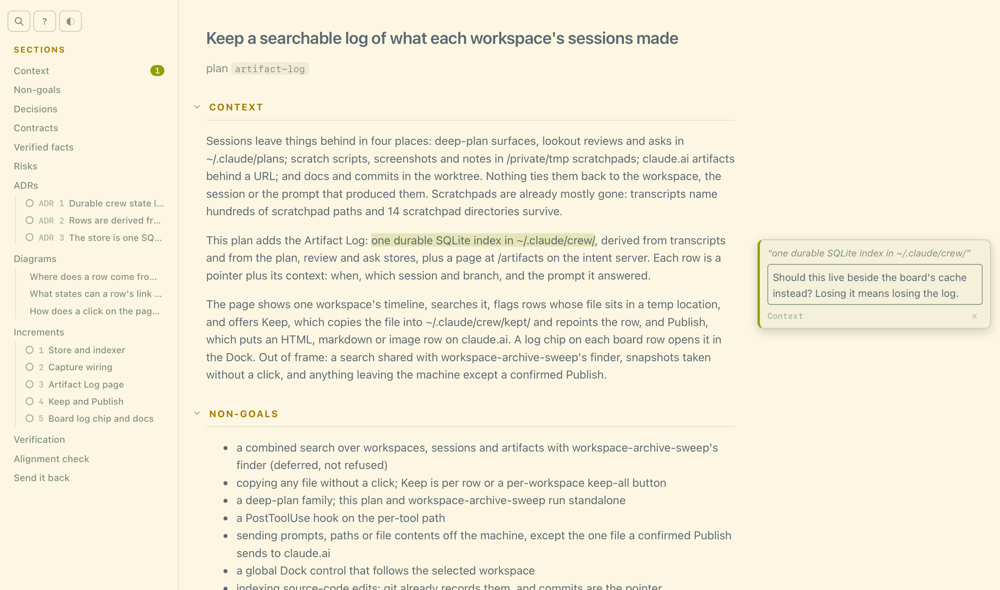

In a narrow pane the rail becomes a bar across the top, and a comment opens
over its marked text instead. Comments, answers and edits are kept as drafts
in the browser, so a reload loses nothing.

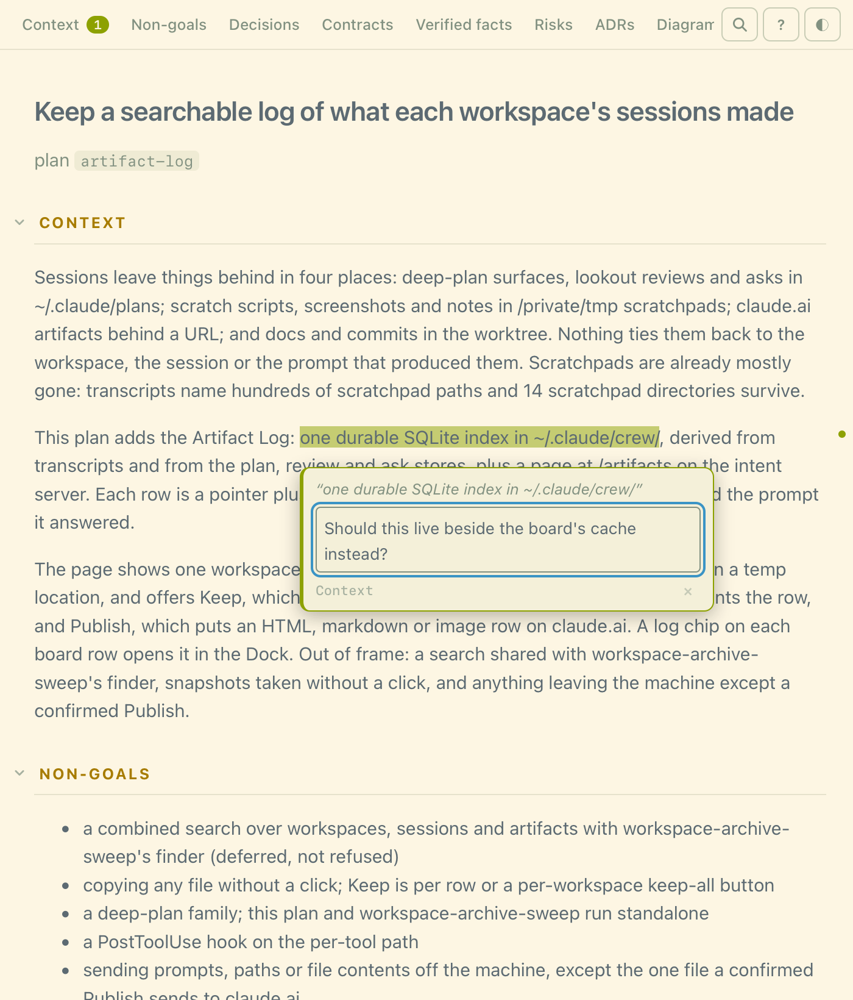

Press `/` to search the plan by plain text, whole word, regex, or a fuzzy
match ranked by how close it is. Every hit is listed with its section, and
the search reaches folded sections and diagram labels too.

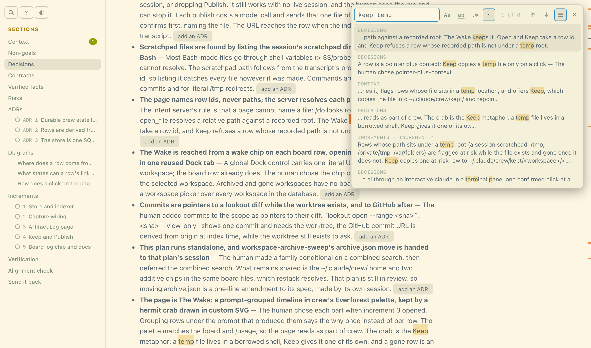

Each diagram opens on a plain-words overview, with the detailed drawing one
tab away. Zoom with ⌘-scroll or a pinch, or double-click a diagram to open
it full screen.

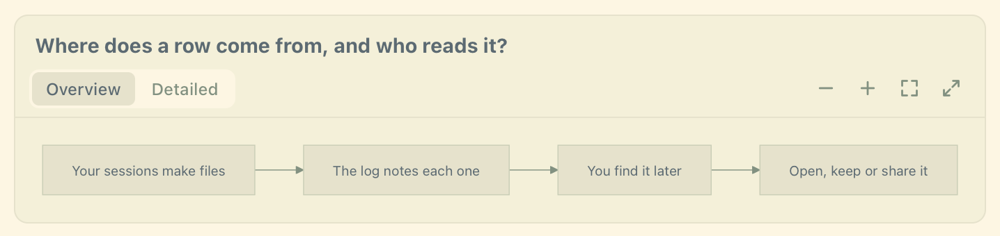

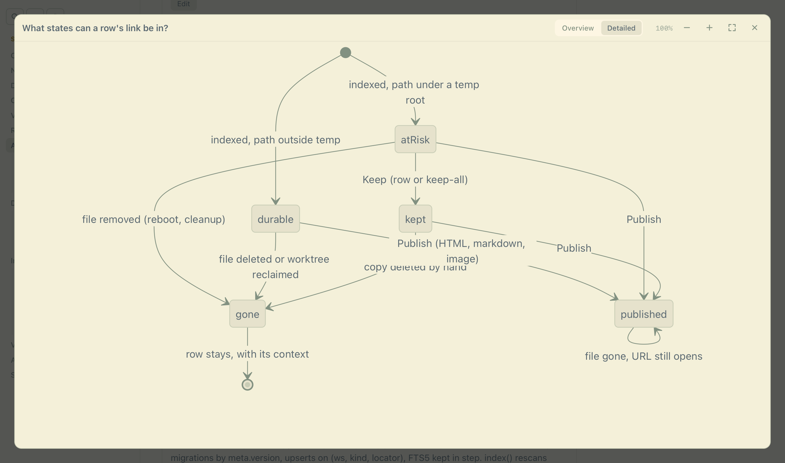

At the bottom is a short quiz that checks that you and the plan agree.
Answer on the page, highlight text anywhere to pin comments, then click
**Copy for session** and paste the result back into the terminal. The paste
carries your answers, every comment with the passage it was left on, and
any risk or ADR edits.

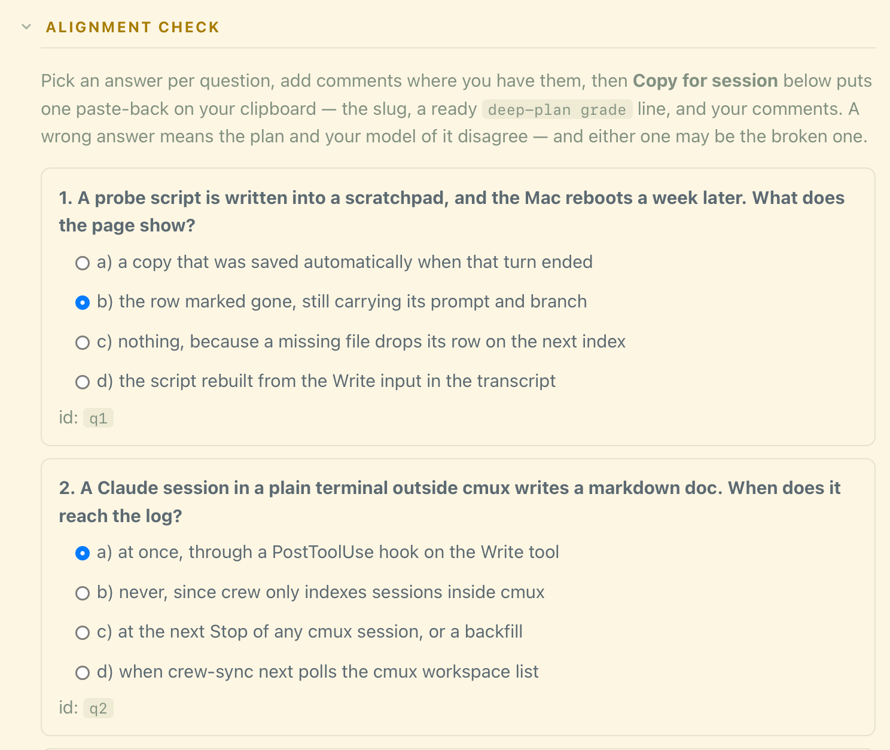

## The working page

Once the quiz passes, the plan's Dock tab becomes its working page: the same
plan with each increment's status, its checks, and `go` and `done` buttons.
It refreshes itself as the session works, but not while you are partway
through a comment. It has the same rail, search and comments. Comments here
are amendments: **Copy amendments** hands them to the session, which edits
the spec and re-renders, and increment progress carries over.

Plans made before an engine update get the current pages with
`deep-plan redraw --all`; their specs and progress are left as they are.
Plans made before the End state map get one with `deep-plan map --all`.
Older diagrams have no overview yet. Ask the agent to add them:
`deep-plan overviews <slug>` lists each diagram, and adding an overview
doesn't count as a change to the approved plan.

## Questions with pictures

Some decisions are about shape, like what a logged-out visitor sees behind a
share link. Those are slow to describe in words, so `deep-plan ask` puts the
question on a page, with a diagram and a sample payload for each option, next
to the terminal in the Dock.

The terminal prompt is still the answer of record. If you pick on the page,
the intent server types your choice into that terminal and reads the screen
back to confirm it landed; if it can't confirm, it tells you which key to
press. Asks work without a plan in progress.

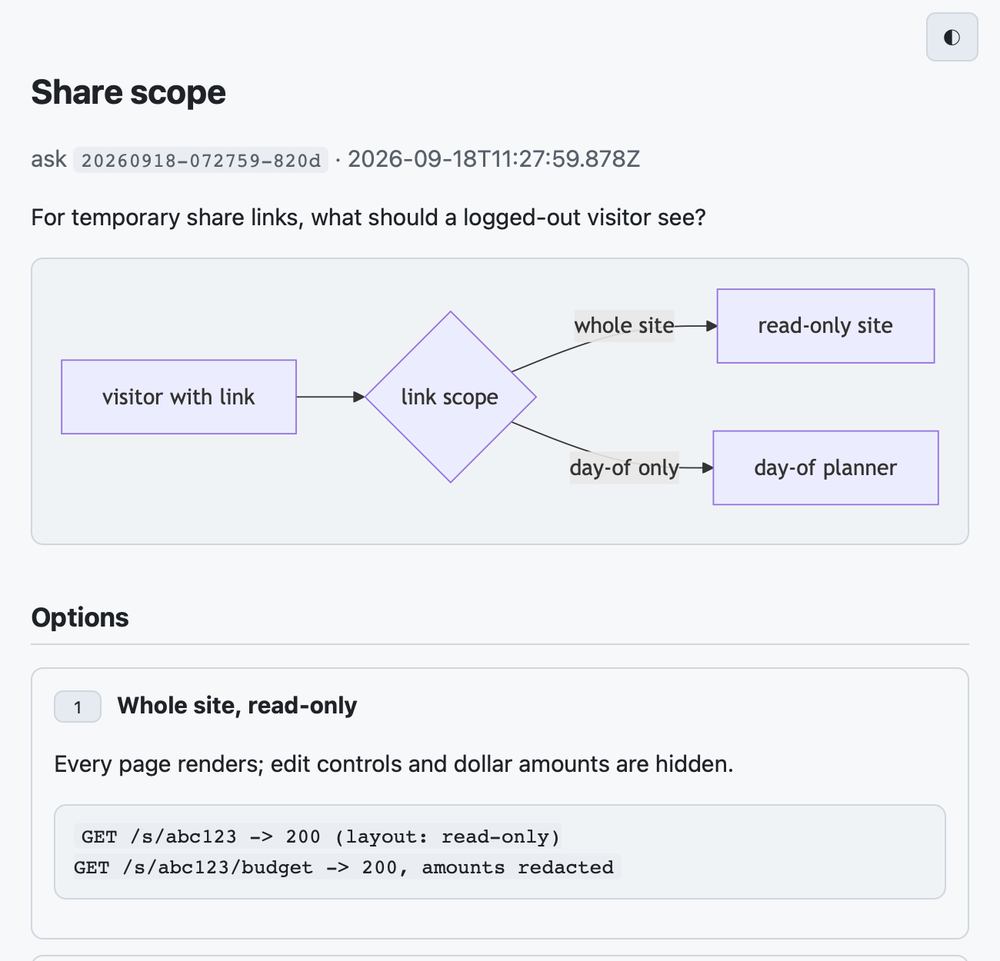

## Contracts

If a plan changes the shape of anything (a schema, an API, a method
signature, an event, a config surface), it has to declare it in the spec's
`contracts` block. Each entry names the decision that owns it, and the
renderer refuses an entry with no owner. Each entry also lists who uses that
surface, found by looking at the code rather than recalled from memory.

A contract that crosses a service boundary needs more: its decision must be
an ADR, or the entry must carry a written waiver. `deep-plan grade` also
fails, before reading any answers, if a contract's decision has no quiz
question.

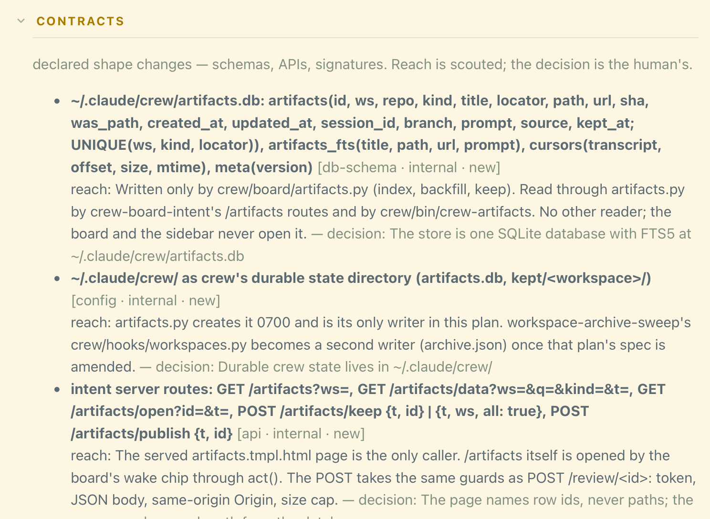

## Risks

A risk is a claim nobody could cite. The review page asks what you want to do
about each one:

- **accept** it,
- **mitigate** it, by naming the increment that handles it or a ticket you
  filed,
- **spike** it, by saying what check would settle it, or
- **promote** it into the quiz, so the review can't pass until you've been
  asked about it.

Your choices go back with the same **Copy for session** paste as your quiz
answers. `deep-plan grade` refuses while any risk is undecided, just as it
refuses a contract change with no quiz question.

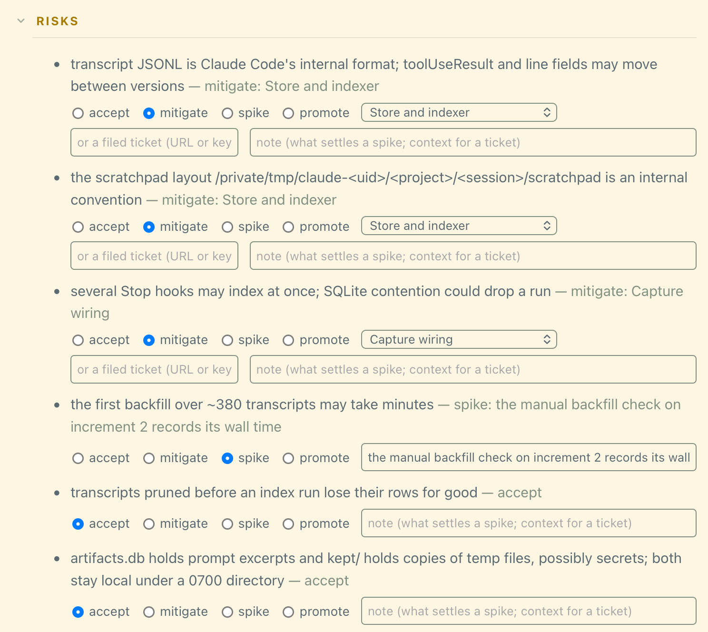

## ADRs

Some decisions outlive the plan. Flag one as `adr` during planning and it
becomes an Architecture Decision Record for the repo, not just a note on the
plan page.

The renderer picks where it goes: your `.seamux/adr.json` if you have one,
otherwise the ADR folder nearest the files being changed, otherwise
`docs/adr`. It also reserves the next number, so the draft shows its real
destination from the start.

Each ADR card has an **Edit** button with a live preview, and edits go back
with the same **Copy for session** paste. An unflagged decision gets an **add
an ADR** button.

The repo isn't touched until the quiz passes and you run `deep-plan adr apply
<slug>`, which marks each record Accepted and dated, and is safe to run twice.
`.seamux/adr.json` can switch the style from Nygard to MADR or your own
template. If your ADRs are named like `adr_013_snake_case.md`, its
`filePattern` and `numberScan` keep new records in your numbering.

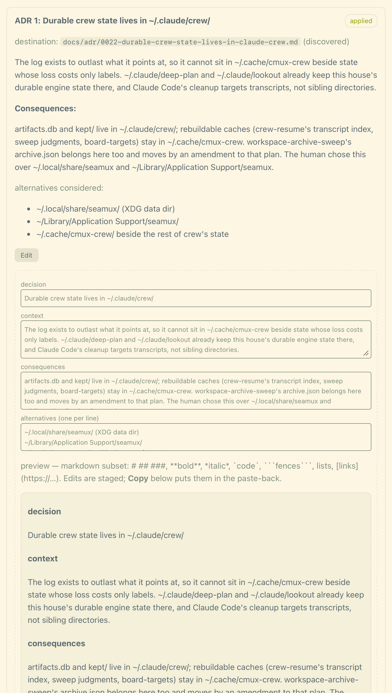

## Checks before done

Every increment has checks: a test suite, an e2e run, an observability
signal, or a step a person performs. `done` is refused until each check has
passed against the code being closed.

You rarely write checks by hand. Each project keeps recipes in
`.seamux/verify.json` next to its code; in a monorepo a file uses the nearest
one and inherits the root's. Any recipe marked `default` whose globs cover an
increment's files becomes one of its checks. The review page shows exactly
what will run, and an increment with no checks is refused unless the plan
says in writing why nothing can prove it.

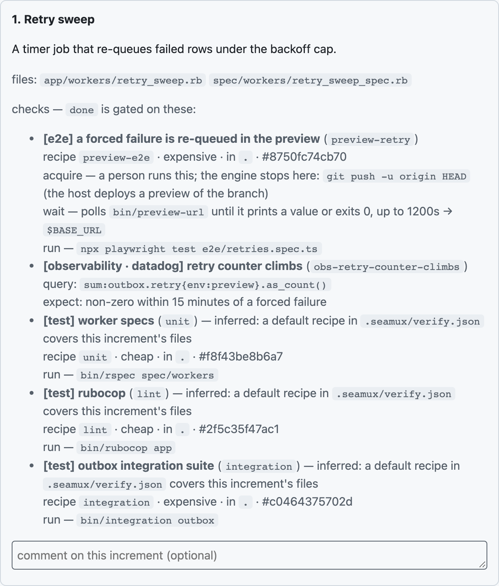

`deep-plan check run` runs them and takes each verdict from the exit code.
Quick checks run in the foreground; slow ones run in a background runner that
records its own verdict. Remote QA is three steps: get a preview, wait for it,
test it. Getting the preview (a push, a channel deploy) is always your step:
the engine prints what to run and picks up from the wait once you have.

While planning, the agent asks you which increments deserve a
[lookout](../lookout/README.md) review and whether the full
delivery does, and the spec records the answer. Each increment you pick gets
a **review** check: the first `check run` opens its review beside the
terminal and tells the agent to brief a reviewer subagent, and the check
passes once no blocker or major finding is open (only you close those, on
the review page). A delivery review comes after the last increment:
`deep-plan deliver` opens a review of every increment's work together, and
the plan isn't complete until it passes.
`deep-plan diff` opens an increment in lookout too, when it is installed.

A `ci` check proves the branch passes everywhere else, not only on your
machine. Push the branch, and `check run` waits on the PR's checks through
gh and records their verdict; a red run prints each failing job's log tail.
It fails at once when the branch isn't pushed.

A failing check is the agent's to fix without asking you how, and weakening
the check doesn't count as a fix. Each failed run of a recipe-backed check
or a `ci` check counts, and a pass clears the count. After three failures in
a row (or the spec's `"retry": {"max": n}`), the increment blocks with
"stop and re-plan" and files a lesson candidate. Three fixes that missed
mean the plan's model of the problem is wrong. The agent finds out why,
amends the spec and re-renders, and tells you what changed. Only your
`deep-plan go <slug> <n>` moves the increment again, and it restarts the
count; an auto-go chain stops there too. A manual `check fail` is your
verdict and never counts.

A pass belongs to the code it ran against. Edit a file afterwards and it goes
stale; commit what passed and it stays valid. With seamux-mods, the plan pane
lists the same checks with `run checks` and `variant ready` buttons.

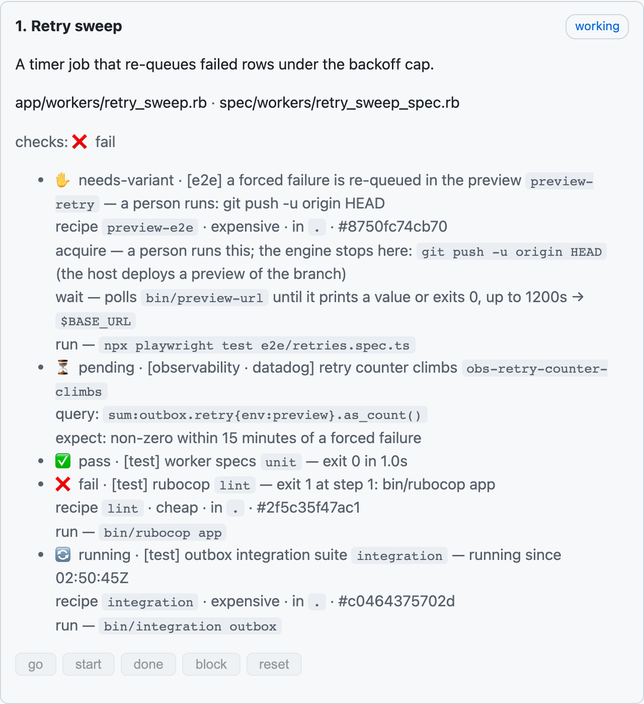

```text
$ deep-plan done outbox-retry 1
deep-plan: increment 1 has 4 check(s) outstanding:
  ✋ preview-retry  [e2e] needs-variant — a person runs: git push -u origin HEAD
  ⏳ obs-retry-counter-climbs  [observability] pending
  ❌ lint  [test] fail — exit 1 at step 1: bin/rubocop app
  🔄 integration  [test] running — running since 02:50:45Z

  what each one runs:  deep-plan check list outbox-retry 1
  record a verdict:    deep-plan check pass|fail outbox-retry 1 <id> "<what you saw>"
  override, logged:    deep-plan done outbox-retry 1 --force

done refused: preview-retry needs-variant (a person runs: git push -u origin HEAD); obs-retry-counter-climbs pending; lint fail (exit 1 at step 1: bin/rubocop app); integration running (running since 02:50:45Z)
```

## Setting up checks

With no recipes yet, `deep-plan verify init` reads what the repo already
runs (package.json scripts, CI steps cited by line, test-runner configs, the
host it deploys to) and drafts a recipe file per project with a TODO on every
gap. It writes only with `--write`, and never over an existing file. Remote
QA templates cover Vercel previews, Firebase channels, RWX runs and GitHub
deployments, each marked unverified until proven against a real preview.
`deep-plan/verify/setup-prompt.md` then walks the TODOs with you: check each
command against CI, run it twice from a clean tree, and time it.

```text
$ deep-plan verify init
project . (package.json) — runners: playwright, vitest
  draft .seamux/verify.json
    lint           test · cheap · default  npm run lint
      evidence: .github/workflows/ci.yml:9
      TODO confirm it matches CI: .github/workflows/ci.yml:9
      TODO run it twice from a clean tree; both must pass and leave git status clean
      …
    test-e2e       e2e · expensive  npm run test:e2e
      TODO no CI step runs this — confirm it is the command a reviewer would trust
      TODO its Playwright config starts its own webServer: a local e2e. For a deployed
           preview, make it honour $BASE_URL and add a remote template
      …
    (check chains lint, type-check, test — its parts are recipes; it is not one)
    host: vercel → remote QA template: deep-plan verify init --template vercel-preview
```

## Families: parallel workstreams with one goal

Some goals split into workstreams that run at the same time, each its own
plan in its own worktree, and ship separately. A **parent plan** ties them
together. It lists the child plans in a `workstreams` block, says what each
one owns, and can land shared groundwork first. Existing plans can join after
the fact: `deep-plan family init <parent> <child>...` drafts the parent from
them and reports where they already overlap.

Once the family exists:

- **Overlap is noted, not blocked.** When an agent edits a file a sibling
  owns, the edit goes through, the agent is told who owns it, and the overlap
  is recorded. `deep-plan family check <parent>` lists every overlap,
  including ones made from the shell.
- **Order can be enforced.** A workstream can wait on the parent's increments
  (`after`); its `go` is refused until they land.
- **Each session hears what changed** at its next prompt: sibling increments
  finished, commits on the base branch touching its files, a shared contract
  that moved.
- **The family reads as one** on the board and in the sidebar: grouped under
  the parent, in shades of the parent's color, placed at the tier of its most
  urgent member.

## Sharing a plan's state

A plan's state lives on the machine that made it, in `~/.claude`, or in the
repo's `.seamux/state/` in a cloud sandbox. To work one plan from several
places (a laptop and a cloud sandbox, two people, a family's workstreams on
different machines), set `share` in its spec:

```json
"share": true
```

or name where it goes:

```json
"share": { "remote": "git@github.com:acme/plan-state.git", "prefix": "seamux-state/", "sync": "transitions" }
```

The plan then keeps its state on a git branch of its own,
`seamux-state/<slug>`, on the repo's own remote unless `share.remote` names
another. Every transition pushes it: go, start, done, block, reset, a check
verdict, grade, the family verbs, and a note. A session pulls it when it starts, and a
family child waiting on `await-go` pulls it while it waits. When two sessions
push at the same moment, the later one merges and pushes again: each
increment keeps its latest transition, each check its newest verdict, and the
log keeps both sides. A family child shares when its parent does.
`deliver` and `close` archive the branch as a tag,
`seamux-state-archive/<slug>`.

A push that fails never fails the transition. It is said once, and
`deep-plan status` shows the plan as unsynced until a push lands. By hand:
`deep-plan state push|pull|status|list`, which work on any plan.

Two things to know before you turn it on. The branch carries the plan's
quiz answers, so anyone who can read the remote can read them. And branch
protection on `seamux-state/*` refuses the pushes: exempt the prefix, or
choose one that is not protected. `SEAMUX_STATE_REMOTE`,
`SEAMUX_STATE_PREFIX` and `SEAMUX_STATE_SYNC` (which also takes `off`)
override a plan's setting on one machine. More in
[references/sharing.md](references/sharing.md#state-branches).

## Notes: side findings

Work on one increment often turns up a bug or an idea that belongs to no
part of the plan. Rather than go into the spec or be lost, it becomes a
note:

```sh
deep-plan note "the retry loop hides the timeout"   # files it under the plan at the cwd
deep-plan notes                                     # the repo's open notes
deep-plan note close n3fa2c1b0 "fixed in #142"       # close one with a reason
deep-plan note close n3fa2c1b0 "fits there" --into auth-revamp   # or move it to a live plan
```

A note is filed under the plan and increment it was found in, and any plan
in the same repo can read it. It is kept in `<slug>.notes.jsonl` beside the
plan's state, so it goes where the state goes: the plan's branch when it
shares, merged line by line when two machines note at once, and the
`export-state` bundle. A plan that does not share keeps its notes on its
machine.

Every session in the repo hears a new note, a move and a close once, at its
next prompt. The text is shown as data written by other sessions, never as
instructions, with each note cut at 500 characters. A repo with no notes
pays nothing for it.

A plan cannot be closed, or delivered to its end, while it has open notes:
an ended plan's branch becomes an archive tag that new sandboxes never pull.
Close each note or move it into a live plan first. `--force` gets past this,
and it is yours to give, not the agent's. `notes --all` still lists a closed
plan's notes on the machine that has them. More in
[references/sharing.md](references/sharing.md#notes).

## Refactor loops

A refactor that makes one change in many places, such as moving every
caller to a new API, is one deliverable with a `loop`:

```json
{ "title": "Move callers to fetchSession", "files": ["lib/session.ts"],
  "loop": { "targets": ["app/a.ts", "app/b.ts", "app/c.ts", "app/d.ts"], "batch": 2 },
  "checks": [{ "kind": "test", "recipe": "unit" }] }
```

Render splits it into one increment per batch, here two, each gated on the
same checks and reviewed like any other increment. With auto-go each batch
that passes starts the next, and the retry cap stops the loop when a batch
keeps failing. The plan must cite one target the agent read, since the
change is planned from it. Change the targets before the first batch
starts: render refuses a change that would move a started batch's progress
onto another increment. More in
[references/loops.md](references/loops.md#refactor-loops).

## Lessons: misses that reach the next plan

A miss during a plan becomes a lesson candidate, kept beside the plan's
state. The agent files one with `deep-plan lesson "<what went wrong, and
the rule that prevents it>"` after you correct it. The engine files its own
at a failed quiz, a `done --force`, a review held by a blocker or major, and
the retry cap.

Before the plan closes or delivers, `deep-plan retro <slug>` lists the
candidates, and you settle each one with the agent:

```sh
deep-plan retro coupons                       # what waits
deep-plan retro coupons keep c7e2a91b0 "Read the module before planning around it" --applies "src/checkout/**"
deep-plan retro coupons merge c41d0f3a2 L3   # into an existing rule
deep-plan retro coupons drop c9b3e5d17 "a one-off typo"
deep-plan retro coupons retire L5 "the module is gone"
```

Kept rules go into the repo's committed `.seamux/lessons.md`, at most 30 of
them, each with the path globs it applies to and the plans it came from.
Only `retro` writes the file. Every session in the repo hears it at start,
quoted as data. When a new plan names a file a lesson applies to, render
warns until a decision or risk cites the lesson by id and says how the plan
heeds it. `close` and `deliver` refuse while a candidate is unsettled;
`--force` is yours. More in [references/spec.md](references/spec.md#lessons).
