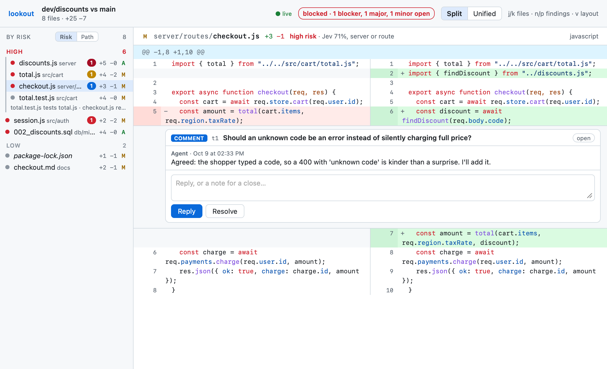
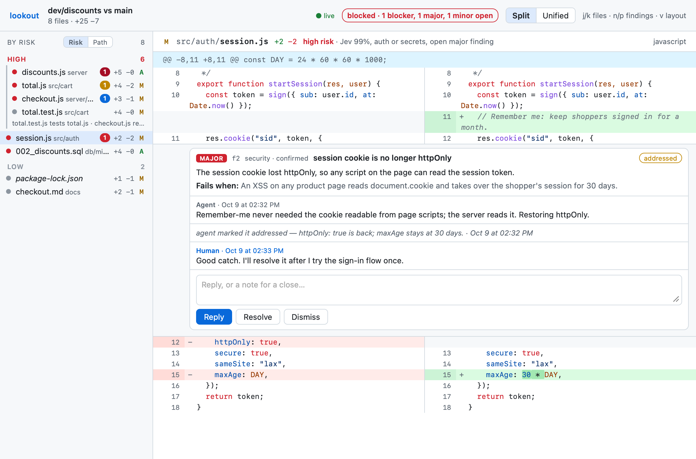
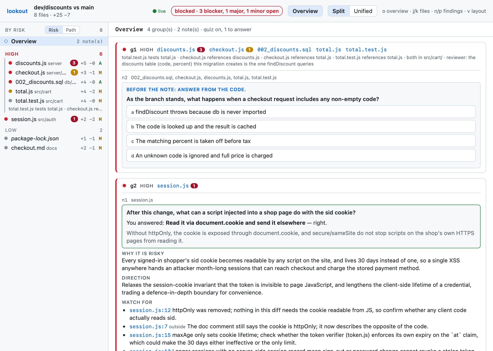

# lookout: review a diff with the agent

Part of [seamux](../README.md). Install and setup are in the [main README](../README.md#setup).

`lookout open` puts a diff in a browser tab beside the terminal: this branch
against its base by default, or `--worktree`, `--range A..B`, `--patch FILE`.
Ask Claude to "review this branch" and it opens the page, briefs a reviewer,
and talks the findings through with you there. Opening a review never
touches your git index.

Outside cmux, lookout serves the page itself and prints `served at <url>`.
In a cloud session, where nobody can reach the sandbox, `lookout
export-artifact` turns the review into a private Artifact page (published
only when you say yes) and `lookout pull` brings your comments and closes
back.

## The page

The layout is VS Code's Source Control view: the changed files on the left,
one file's diff on the right, split or unified (`v`), with `j`/`k` to move
between files. Highlighting covers each side's whole file, so a change
inside a block comment still reads as a comment, and changed words are
marked. Lockfiles, generated and very large files start collapsed.

The file list has two orders. **Path** is a folder tree. **Risk** puts the
riskiest files first, in high, medium and low bands, with related files
grouped on a rail that says why they belong together: one imports the
other, a test and its source, a finding that names both. Risk blends simple
signals (how much changed, whether the path is auth, a schema, a server or
config, whether it is only tests) with one Jev score per file. By default
only paths and line counts go to TypeSafe; `.seamux/lookout.json`
`{"sendContent": true}` lets the changed lines go too. Without TypeSafe the
page says it is ranking on the signals alone.

## Findings and threads

Findings come from one fresh reviewer subagent, not from the agent that
wrote the code. `lookout prompt <id>` prints its brief: the diff, the files
riskiest first, a rubric across correctness, security, performance and
maintainability, and the JSON to write. Each finding is `/code-review`'s
shape plus a severity (blocker, major, minor, nit), and it sits under its
line with a thread. `n`/`p` step through them.

When crew's intent server is running the page is live. Click a line number
to comment, reply under a finding, resolve or dismiss it. What you write
reaches the agent at its next prompt, and its replies (`lookout reply`)
appear on the page without a reload. Without crew the page opens as a
read-only file.

Only you close a finding. The agent can reply and mark one addressed; it
can resolve or dismiss only when the review was opened with
`--agent-may-close`, which a plan sets with `review.agentMayClose`.

## Group notes

Findings say what is wrong. Alongside them the reviewer writes a note for
each risky group of files: why it is risky, the direction it moves the
design (a boundary moved, an invariant relaxed, a new dependency between
systems), what to check by hand at which lines, and which fundamentals it
touches. A review with notes opens on an **Overview** (`o` toggles it) that
lists the groups riskiest first, so you can judge the architecture before
reading lines; each file shows its group's note as a strip above the diff.
The reviewer can also link files the grouping rules missed, such as a
migration and the query that reads its table, and the link's reason shows
on the group's rail.

`lookout open --quiz` (or `.seamux/lookout.json` `{"quiz": true}`, or a
plan's `review.quiz`) adds a question to each high-risk group and hides its
note until you answer, so you form your own reading of the change before
you see the agent's. The quiz never gates anything. A wrong answer reaches
the agent at your next prompt, so it can explain the gap if you ask; a right
one stays yours. Answers need crew's intent server: opened as a file, the
page shows the notes in full.

A review deep-plan opened also has a **Map** view (`m`, or the header
button): the plan's End state map held against the diff. Files the plan
named and the diff touched get a tick; files it named but the diff never
touched, and files the diff touched but the plan never named, are flagged,
the second with the increment that does plan them. A card with findings
carries a flag with how many are still open, coloured by the worst; its
panel lists them, and a click on one jumps to the line. Click a card again,
or use **Open its diff**, to open a touched file's diff.

Inside a plan, a group that heads somewhere the increment's description
does not is filed as a `plan-drift` finding, always major or worse. It
holds the review check until you close it; dismissing it records that the
deviation was meant.

## Following a pull request

When the branch under review has an open pull request, lookout follows it.
The page shows a strip under its header with the PR, how many commits its
head is past the review, and its checks; a click on the checks lists them,
failed first. GitHub's review threads sit on their lines beside lookout's
own findings. A finding is marked pending until it is posted and posted
once it is, with a link and GitHub's replies under it. One whose code
changed on the PR's head is marked stale.

`lookout gh post <id> f1 f3` posts findings as one GitHub review; the seamux
app's Lookout tab does the same from its Post button, for a pasted PR or a
review a session opened. The app also watches linked PRs and raises a
banner for a new comment from someone else or a check that turns red; a
click opens that review on the comment or the checks. lookout never
answers or resolves GitHub's threads itself, and never starts a fix.

## Reviews in a plan

`lookout gate` answers 0 when no blocker or major finding is open. A
deep-plan increment you chose for review has a check that runs it, so the
increment can't be done until you have closed those findings, and a plan
with a delivery review can't be complete until its review passes (see
[Checks before done](../deep-plan/README.md#checks-before-done)). On a plain branch nothing gates
on it: the review is a conversation.
